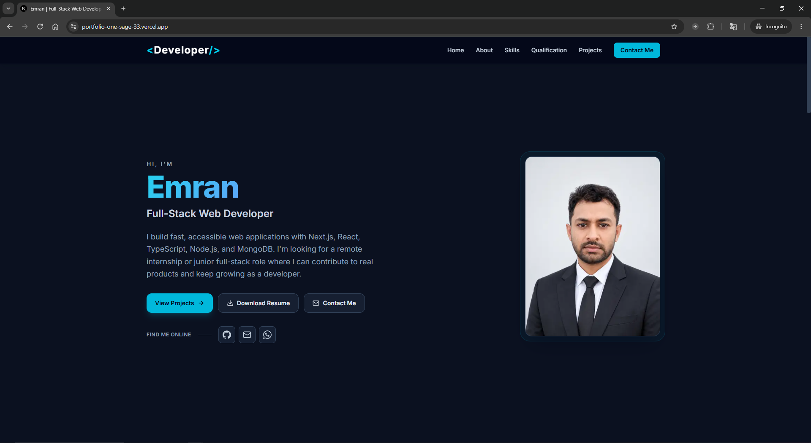

# Emran — Developer Portfolio

Personal portfolio of **Emran**, a Full-Stack Web Developer focused on building modern, responsive, and user-friendly web applications.

## 🌐 Live Portfolio

**[Visit My Portfolio](https://portfolio-one-sage-33.vercel.app)**

## 📸 Portfolio Screenshot



## 🚀 Tech Stack

- **Framework:** Next.js 16 (App Router, Turbopack, React Compiler)
- **Frontend:** React 19, TypeScript (Strict Mode)
- **Styling:** Tailwind CSS v4
- **Icons:** Lucide React
- **Fonts:** Inter via `next/font`
- **Backend:** Node.js, Next.js Route Handlers
- **Email Service:** Resend API
- **Deployment:** Vercel

## ✨ Features

- Modern, responsive portfolio design
- Single-page layout with anchor-linked sections
- Dedicated project detail pages
- Project cards and project details
- Downloadable resume
- Contact form with validation
- Server-side email delivery using Resend
- Loading, success, and error states for the contact form
- SEO metadata and Open Graph support
- Sitemap and robots configuration

## 🛠️ Getting Started

### Prerequisites

- Node.js
- npm

### Installation

Clone your GitHub repository:

```bash
git clone YOUR_GITHUB_REPOSITORY_URL
```

Navigate to the project folder:

```bash
cd my-portfolio
```

Install dependencies:

```bash
npm install
```

Start the development server:

```bash
npm run dev
```

Open [http://localhost:3000](http://localhost:3000) in your browser.

## 📜 Available Scripts

| Command | Description |
| --- | --- |
| `npm run dev` | Start the development server |
| `npm run build` | Build the application |
| `npm run start` | Run the production server |
| `npm run lint` | Run ESLint |
| `npx tsc --noEmit` | Check TypeScript types |

## 📂 Project Structure

```text
my-portfolio/
├── public/
│   ├── images/
│   │   └── Portfolio.PNG
│   ├── og.png
│   └── resume.pdf
├── src/
│   ├── app/
│   │   ├── api/
│   │   │   └── contact/
│   │   │       └── route.ts
│   │   ├── project/
│   │   │   └── [id]/
│   │   │       └── page.tsx
│   │   └── page.tsx
│   ├── components/
│   ├── data/
│   │   └── projectsData.ts
│   └── lib/
│       └── site.ts
├── .env.example
├── package.json
└── README.md
```

## ✏️ Customization

### Projects

Add or update projects in `src/data/projectsData.ts`. The project grid, modal, and project detail pages use this data.

### Images

Store your profile photo and project screenshots in:

```text
public/images/
```

The portfolio screenshot is:

```text
public/images/Portfolio.PNG
```

### Resume

Replace `public/resume.pdf` with your updated resume.

### Website URL

Configure `NEXT_PUBLIC_SITE_URL` with your production website URL for canonical URLs and SEO metadata.

## 📬 Contact Form Setup

The contact form uses the Resend API through a server-side Next.js route handler.

1. Create an account at [Resend](https://resend.com).
2. Generate an API key.
3. Copy `.env.example` to `.env.local`.
4. Configure the required environment variables.
5. Verify your sender domain or configure an eligible test sender.

Example `.env.local` configuration:

```env
NEXT_PUBLIC_SITE_URL=https://portfolio-one-sage-33.vercel.app
RESEND_API_KEY=re_your_api_key
CONTACT_TO_EMAIL=emransani01@gmail.com
CONTACT_FROM_EMAIL=Portfolio Contact <onboarding@resend.dev>
```

**Security:** Never commit `.env.local` or expose your API keys in your public repository.

Without a valid `RESEND_API_KEY`, the contact form reports that email delivery is unavailable instead of showing a false success message.

## 🚀 Deployment

This portfolio is deployed on [Vercel](https://vercel.com).

To deploy updates:

1. Push your changes to GitHub.
2. Import or connect the repository in Vercel.
3. Configure the required environment variables.
4. Deploy your application.

## 🔗 Links

- **Live Portfolio:** [portfolio-one-sage-33.vercel.app](https://portfolio-one-sage-33.vercel.app)
- **GitHub Repository:** Add your repository URL here.
- **Email:** emransani01@gmail.com

---

**Built with ❤️ by Emran**
